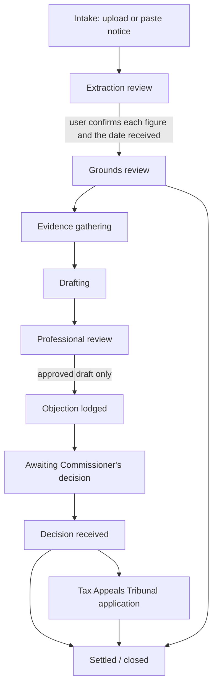

# TaxComp architecture: seven service centres and the three foundations

Opitekene Consultancy Limited. *One platform. Two experiences. Equal intelligence.*

This document maps the Master Development Directive onto the existing TaxComp code and describes the three foundations. It also gives the blueprint for the **Challenge an Assessment** module.

## 1. The seven service centres and where they live

| # | Service centre | Existing modules | Status |
|---|---|---|---|
| 1 | Tax Computation | `tax-calculator.js`, `tax-rules.js`, `corporate-tax.js`, `capital-gains.js`, `capital-allowances.js`, `industrial-building.js`, `international-tax.js`, `multi-tax-analysis.js`, `tax-computation-explanation.js` | Live: 11 calculators on the FY 2026/27 engine. Presumptive tax and excise duty calculators are not built yet. |
| 2 | URA Assessment & Dispute Resolution | **`assessment-challenge.js` (new)**, `document-to-tax-analysis.js` | Foundation built and tested. No screens yet. |
| 3 | Tax Audit Preparation | `audit-health.js` (audit checklists) | Checklists live. Reconciliation tooling not built yet. |
| 4 | Tax Health Check | `audit-health.js` (health-check items) | Checklists live. |
| 5 | Ugandan Tax Law & Case Law | **`law-register.js` (new)**, `legal-source-registry.js`, `legal-source-workflow.js`, `case-law-registry.js`, `legal-retrieval.js`, `phase8-legal-intelligence.js` | Point-in-time register built. The register content still has to be entered and verified. |
| 6 | AI Tax Advisory | `ai-tax-advisor.js`, `tax-advisory.js`, `tax-answer.js`, `tax-clarification.js`, `worker/claude-research.mjs` | Live. Claude research is waiting for the `ANTHROPIC_API_KEY` secret. |
| 7 | Compliance & Monitoring | `compliance-calendar.js`, `phase6_obligations` | Calendar live. Legislative-change alerts not built yet. |

## 2. Foundations

### A. Uganda Tax Law Register

Migration [`20261110000000_law_register_intelligence_assessments.sql`](supabase/migrations/20261110000000_law_register_intelligence_assessments.sql). Resolver: [`law-register.js`](law-register.js).

| Table | Holds |
|---|---|
| `law_instruments` | Principal Acts, amendment Acts, regulations, practice notes, public rulings, bills and treaties, each with a legislative status: `bill` / `passed` / `assented` / `commenced` / `repealed` / `unconfirmed`. |
| `law_provisions` | Each section as numbered **versions** (`provision_key` such as `tpca:s24(1)`, plus `version_no`) with effective dates. Old text is never overwritten. |
| `law_amendments` | Which instrument inserted, substituted, amended or repealed which provision, and from when. |
| `law_time_limits` | Statutory periods as data: objection, the Commissioner's decision, and application to the TAT. |

Rules enforced in the database and in code:

1. **Bills are not law.** A provision is applied only when its source instrument is `commenced` and `verified` and the date falls inside its effective range. Changes from bills, or from Acts that are unconfirmed or not yet in force, are returned as `pendingChanges` and labelled "Proposed (bill) - not law". This is also the Phase 7 rule that keeps proposed bills separate from enacted law.
2. **Nothing is verified without evidence.** A `verified` row must carry an official HTTPS URL, a reviewer and a date. A CHECK constraint enforces this.
3. **Point in time.** `resolveProvision(key, date)` returns the text that applied on that date, so a 2024/25 assessment is read against 2024/25 law.

**The 2026 Amendment Acts** (Income Tax, VAT, Excise Duty and Tax Procedures Code) are seeded as `unconfirmed` and `pending-review`. I could not confirm their assent dates, Act numbers or commencement from an official source. Until a reviewer enters these from the Gazette or ULII and verifies them, the resolver will not treat their text as law. The principal Acts are seeded as `commenced` but also `pending-review`, with notes asking for the chapter numbers in the Laws of Uganda 2024 Revised Edition (the Compendium PDF in this folder).

### B. Uganda Tax Case Repository

| Table | Holds |
|---|---|
| `tax_cases` | Forum (TAT, High Court, Court of Appeal or Supreme Court), citation (unique), decision date, background, issues, decision, outcome, and appeal history (`appeal_of_case_id`, `appeal_status`). |
| `tax_case_principles` | Legal principles with a paragraph reference, indexed by tax head. |
| `tax_case_provision_links` | Which provisions a case interprets, applies or distinguishes. This links Centre 5 to the register. |

The existing `case-law-registry.js` validation (required fields, reviewer and source URL) applies when these tables are filled.

### C. TaxComp Intelligence Architecture

[`taxcomp-intelligence.js`](taxcomp-intelligence.js) builds on the existing `tax-question-classifier.js`.

1. **Audience.** It uses the user's own choice if there is one. Otherwise it detects professional wording (section citations, ITA, VATA, TPCA, "my client", technical terms). If neither applies, it defaults to the business-owner experience. The same intelligence serves both; only the labels and next steps differ.
2. **Routing.** It routes to one of the seven centres. An uploaded document type decides first (a URA assessment or objection decision goes to Disputes; an audit notice goes to Audit). Then it checks plain wording, for example "URA sent me a letter saying I owe" goes to Disputes. Last, it uses the classifier's intent.
3. **Escalation to a human** (Phase 9) in these cases:
   - criminal exposure (fraud, prosecution)
   - enforcement action (agency notice, seizure)
   - Tribunal or court matters
   - disputes of UGX 50,000,000 or more. This threshold is an Opitekene policy setting, not law, and can be changed in `DEFAULT_POLICY`.
4. **Clarifying questions:** which tax, which period, and the date the notice was received.
5. **Privacy:** `intel_triage_log` stores routing metadata only, never the question or the document text. A test enforces this.

It never states a tax conclusion (`advisoryConclusionProvided: false`). Conclusions come from the centre it routes to.

## 3. Blueprint: Challenge an Assessment

[`assessment-challenge.js`](assessment-challenge.js), with the tables `assessment_challenges`, `assessment_challenge_items`, `assessment_challenge_deadlines`, `assessment_challenge_evidence`, `assessment_challenge_drafts` and `assessment_challenge_events`. A challenge belongs to a client within a firm workspace and cannot reference another firm's client (enforced by a composite foreign key).

### Workflow

`nextStage()` enforces these transitions. An objection **cannot be marked lodged** unless a professional has approved the draft. The database also requires a reviewer and date on any approved or rejected draft.

### Steps

| Step | Function | What the business owner sees | What the professional sees | Safeguard |
|---|---|---|---|---|
| 1. Read the notice | `extractAssessmentFacts` | "We found these figures - are they right?" | Reference, TIN, assessment type, period, principal / penalty / interest / total, cited sections mapped to register keys | Every field shows the text it came from and needs confirmation. **The issue date is never taken as the date of service.** A total that does not add up is flagged as a possible ground. |
| 2. Deadline | `computeChallengeDeadlines` | "You have N days to object" with a red / amber / green urgency | Due date, rule used, the rule's verification status | Counted from the day after the user-confirmed service date. **Labelled PROVISIONAL** while the 45-day rule is unverified. If overdue, it suggests asking about an extension. |
| 3. Grounds | `evaluateGrounds` | Nine plain questions ("Did URA treat loans as sales?") | Candidate grounds rated supported / arguable / needs-evidence / weak | Ratings reflect the evidence only and never the likely outcome. The time-limit ground carries a "verify first" caution. |
| 4. Evidence | `buildEvidenceChecklist` | A checklist to tick off | The same list with the reason for each item | Combines items needed for every objection, for the tax head and for each ground. |
| 5. Risk | `classifyRisk` | Low / medium / high / critical | Score and reasons | High or critical, enforcement, or an amount at or above the threshold all recommend professional review. |
| 6. Draft | `draftObjection` | "Your draft is ready for review" | A letter to the Commissioner General with `[CONFIRM ...]` placeholders | Headed "DRAFT - NOT FOR SUBMISSION UNTIL REVIEWED". The objection section stays a placeholder until the register rule is verified. Payment-on-objection is a placeholder to confirm. |
| 7. Escalate | Phase 9 | "An Opitekene consultant will review this" | Review queue | `escalated_to_professional`, and the draft review statuses. |

### What it will not do

- Promise that an objection will succeed.
- Treat the notice date as the date of service.
- Present a deadline as certain while the rule is unverified.
- Treat a bill or an unconfirmed amendment as law.
- Mark an objection lodged without professional approval.

## 4. Phase plan status

| Phase | Status |
|---|---|
| 1. Law Register and ingestion | **Schema, resolver and seed done.** Next: an ingestion screen and the review workflow (reusing `legal-source-workflow.js`), then entering sections from the Compendium and the 2026 Acts. |
| 2. Non-expert conversational AI | Triage router done. Next: connect it to the assistant chat so the first reply routes the user. |
| 3. Rules and computation engine | Live (FY 2026/27). Missing: presumptive tax and excise duty. |
| 4. Assessment analysis and disputes | **Engine done** (this document). Next: Worker API routes and the screens. |
| 5. Audit preparation and health check | Checklists live. Next: reconciliations (returns to ledger, bank and EFRIS). |
| 6. Case-law intelligence | Schema done. Next: enter verified TAT and court decisions, then add search. |
| 7. Legislative monitoring | The bill / enacted separation is built into the register. Next: a change feed and alerts. |
| 8. Workspace and dashboard | Live (Phase 6 workspace). The challenges attach to its clients. |
| 9. Professional review | Escalation rules are built. Next: the review queue screen. |

## 5. What needs a qualified person

These cannot be done by code and must be signed off by a qualified reviewer before the matching feature shows a verified result:

1. The objection period (`objection-to-assessment`, seeded at 45 days), the Commissioner's decision period (90) and the TAT application period (30). Check each against the current TPCA and TAT Act, including any change by the TPC (Amendment) Act 2026. Then set `verified` with the URL, reviewer and date.
2. Assent, Act number and commencement of each 2026 Amendment Act.
3. Section numbering in the 2024 Revised Edition. The seeded keys use the familiar numbering (for example `tpca:s24(1)`) and may need remapping.
4. Whether payment is required on objection, the limitation period on assessments, and their exceptions.
